# Event Connect

A full-stack **campus event management platform**. Students discover and enroll in events, organizers (clubs) publish and manage events and their participants, and admins moderate content and approve events.

Built with **React + Vite** on the frontend and **Node.js + Express + MongoDB** on the backend, with JWT authentication, email verification over Gmail SMTP, and image uploads to Cloudinary.

The interface is a clean **black & white glass design** with **dark and light themes**, a floating rounded header, a macOS Dock–style tab bar on the home screen, and smooth, restrained animation built with **Framer Motion** and **GSAP**. It is responsive from phones to wide desktops.

> Every change to the project is logged step by step in [`plan.md`](plan.md).

---

## Table of Contents

1. [Features](#features)
2. [Tech Stack](#tech-stack)
3. [UI & Design System](#ui--design-system)
4. [Project Structure](#project-structure)
5. [High-Level Design (HLD)](#high-level-design-hld)
6. [Low-Level Design (LLD)](#low-level-design-lld)
   - [Data Model (ER Diagram)](#data-model-er-diagram)
   - [Backend Class / Module Diagram](#backend-class--module-diagram)
   - [Frontend Component Tree](#frontend-component-tree)
   - [Sequence Diagrams](#sequence-diagrams)
   - [Auth & Verification State Machine](#auth-and-verification-state-machine)
7. [API Reference](#api-reference)
8. [Frontend Routes](#frontend-routes)
9. [Validation Rules](#validation-rules)
10. [Getting Started](#getting-started)
11. [Environment Variables](#environment-variables)
12. [Known Issues & Limitations](#known-issues--limitations)
13. [Future Improvements](#future-improvements)

---

## Features

### Authentication and security
- **Three roles**: Student, Organizer, Admin, each with its own signup/signin flow.
- **Email verification**: on signup, a random 32-byte token is stored and a verification link is emailed via Nodemailer (Gmail SMTP). The token expires automatically after **1 hour** (MongoDB TTL index).
- **Re-send on login**: if an unverified user tries to sign in, a fresh verification email is sent and login is blocked.
- **Password hashing** with bcrypt.
- **JWT auth**: the token is sent in the `Authorization` header. Organizer tokens expire after 1 hour.
- **Role-based access control**: `verifyUser` middleware decodes the JWT, then route-level guards (`validPerson`, `validAdmin`) check that the user id belongs to the right collection.
- **Request validation** with Zod schemas (signup, signin, event creation).
- **Persisted session**: user state lives in a Recoil atom persisted to `localStorage` (`recoil-persist`), so login survives page refresh.

### Student features
- Browse all events in a card grid (name, category, image, dates).
- View full event details: description, venue and map link, fee, FAQs, key takeaways, sample certificate, reward points, and seats left.
- **Enroll in events**. Duplicate enrollments are blocked, and the event's `enrolled` counter is incremented.
- **Earn reward points** on every enrollment (added to `rewardsEarned`).
- **Comments**: add, edit, and delete your own comments on an event.
- **Enrolled events** page.
- **Personal calendar** of enrolled events, and a **global events calendar** of all events. Both open on today and have a side panel listing every event running on the selected day, including multi-day events, with a details pop-up.
- **Home screen** with a centered macOS Dock–style tab bar to switch between Events, Enrolled, My Calendar, Calendar, Gallery and Dashboard.
- **Club gallery**: browse every organizer/club by logo and open a club page listing its events.
- **Dashboard**: view and edit your profile (username, phone, department, year), and see reward points.

### Organizer (club) features
- Signup with club name, position, department, and **club logo uploaded to Cloudinary**.
- **Post events** with the full form: name, description, category, max seats, start/end dates, end time, venue and venue link, registration fee, registration form link, registration end date, reward points, key takeaways, a dynamic FAQ list, an event image, and a sample certificate (both uploaded to Cloudinary). A confetti animation plays on success.
- **Edit / delete** your own events. Ownership is checked on the server.
- **Created events** list.
- **Event participants**: choose one of your events to see the enrolled students, then **export the list to Excel (xlsx) or PDF (jsPDF + autotable)**.
- **Organizer calendar** of your own events (upcoming, in progress, or completed), plus the global calendar.
- **Dashboard**: profile info and stats (total, ongoing, upcoming, and completed events), plus a list of ongoing events.
- **Home screen** Dock with Events, Post Event, Created, Calendar and Dashboard.

### Admin features
- Admin signup (API) and signin.
- **Approve or update any event** (`isApproved` flag), through the API.
- **Moderate comments**: delete any comment on any event, through the API.
- **Admin dashboard** with shortcuts to All Events, Approvals and Moderation. Browse all events and view event details.

### UI / UX
- **Dark and light themes** with a sun/moon toggle in the header. The choice is saved, applied before the page paints (no flash), and switched with a circular reveal. See [UI & Design System](#ui--design-system).
- **Floating rounded header** with space around it, and a **floating rounded sidebar** that is role-aware and collapsible (Recoil `sidebarOpenState`). On phones the sidebar slides in from a button in the header.
- **Glass surfaces**: translucent, blurred cards and bars that work in both themes.
- **Home Dock**: a macOS-style tab bar with gentle magnification and a sliding active indicator.
- **Polished calendars**: custom toolbar, today badge, selected-day highlight, themed events and "+N more" pop-up.
- Loading spinners and friendly empty states on every list. Toasts follow the theme.
- Forms built with React Hook Form, with shared input/button styles.

---

## Tech Stack

| Layer | Technology |
|---|---|
| Frontend framework | React 18, Vite 6 |
| Routing | React Router v6 (nested, role-scoped routes) |
| State | Recoil + recoil-persist |
| Forms | React Hook Form |
| Styling | Tailwind CSS 3 (theme colours via CSS variables, `darkMode: 'class'`), PostCSS, Autoprefixer, `clsx`, `tailwind-merge`, Inter font |
| Animation | **Framer Motion** (`motion` package, `motion/react`), **GSAP** + `@gsap/react` (`useGSAP`, ScrollTrigger) |
| Icons | lucide-react (Home Dock), @tabler/icons-react (everywhere else), react-icons |
| UI libraries | react-big-calendar (+ moment, which it installs), date-fns, react-toastify, react-confetti, react-use, pure-react-carousel |
| Exports | xlsx (Excel), jsPDF + jspdf-autotable (PDF) |
| HTTP client | Axios |
| Backend | Node.js, Express 5 |
| Database | MongoDB with Mongoose 9 |
| Auth | jsonwebtoken, bcryptjs |
| Validation | Zod 4 |
| Email | Nodemailer (Gmail SMTP) |
| Media storage | Cloudinary (unsigned upload preset, direct from the browser) |

---

## UI & Design System

### Look and feel
- **Monochrome**: black, white and greys only, with no accent colour.
- **Glass**: translucent surfaces with backdrop blur (`.glass`, `.glass-strong`, `.glass-bar` in `index.css`).
- **Type**: Inter, tight tracking, a soft white-to-grey gradient on headings (`.text-gradient`).
- **Shared controls**: `.field`, `.field-label`, `.field-error`, `.btn-primary`, `.btn-ghost`, `.chip`.

### Theming (dark / light)

Tailwind's `white`, `black` and `neutral-*` colours resolve to CSS variables. In light mode the variables swap: "white" becomes the ink colour, "black" becomes the paper colour, and the grey scale reverses. Ordinary classes like `text-white`, `bg-white/10` and `text-neutral-400` therefore work in both themes without per-component changes.

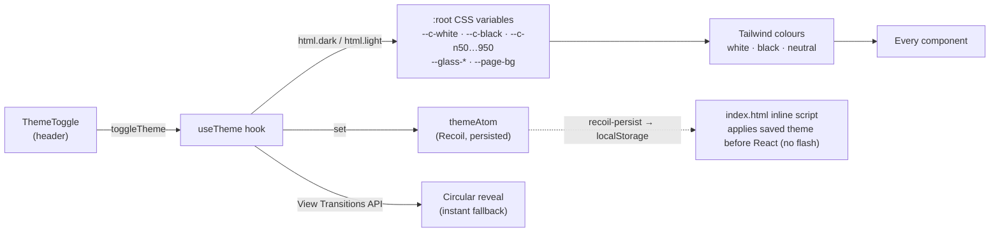

| Piece | File |
|---|---|
| Colour tokens, light palette, glass, calendar styles | `Client/src/index.css` |
| Tailwind colour mapping (`rgb(var(--c-*) / <alpha-value>)`) | `Client/tailwind.config.js` |
| Theme state + toggle logic | `Client/src/components/theme/useTheme.js` |
| Sun/moon button | `Client/src/components/theme/ThemeToggle.jsx` |
| No-flash script | `Client/index.html` |

### Layout
- **Header**: a floating `rounded-full` glass pill, inset from the edges (`top-4`, side gaps). It holds the brand, role badge, theme toggle and auth buttons, and gains a soft shadow once the page scrolls. On phones it also holds the sidebar button.
- **Sidebar**: a floating rounded glass panel (`left-4 top-24 bottom-4`), collapsible on desktop and a slide-in drawer on phones. The active item has a white pill that slides between links.
- **Content**: `pt-24` clears the floating header, and the left margin follows the sidebar width.

### Animation
Animation is deliberately simple: one-time entrances, gentle hovers, and no looping or decorative effects.

| Library | Where |
|---|---|
| **GSAP** | Landing intro (hero copy, then sample cards); one-time scroll fade-ups (features, call to action); Home intro; Dock click press |
| **Framer Motion** | Header and page fade-ins; staggered card grids; small hover lift on cards; sliding active pills (sidebar, sign-up role switch); Dock magnification and active indicator; hero word swap; modal, FAQ and comment transitions; theme icon swap |

- `MotionConfig reducedMotion="user"` and GSAP `matchMedia` respect the OS "reduce motion" setting.
- Effects that rely on hovering are turned off on touch screens.

### Shared UI components (`Client/src/components/ui/`)
| Component | Purpose |
|---|---|
| `Page.jsx` | `Page` (fade-up wrapper), `PageHeader`, `EmptyState`, `Spinner`, stagger variants |
| `EventCard.jsx` | Glass event card used by every event list |
| `Stat.jsx` | `StatTile`, `InfoRow`, `Avatar` for the dashboards |
| `CalendarView.jsx` | Shared calendar: custom toolbar, month grid, day panel, details pop-up (portaled) |
| `Dock.jsx` | macOS Dock–style tab bar for Home: scale-only magnification (no layout shift), always-visible labels, sliding active indicator |

---

## Project Structure

```
Event-Connect/
├── Client/                         # React + Vite frontend
│   ├── src/
│   ├── index.html                  # Inter font + no-flash theme script
│   ├── src/
│   │   ├── main.jsx                # App entry + all route definitions (+ MotionConfig)
│   │   ├── RootLayout.jsx          # Header + Sidebar + <Outlet/> + Footer + themed Toasts
│   │   ├── index.css               # Theme tokens, glass, shared form/button styles, calendar styles
│   │   ├── components/
│   │   │   ├── UserAtom.js         # Recoil user atom (persisted)
│   │   │   ├── atoms/sidebarAtom.js
│   │   │   ├── theme/              # useTheme (themeAtom + toggle), ThemeToggle
│   │   │   ├── common/             # Shared pages: Landing, Home, SignIn/Up, Verify, Events,
│   │   │   │                       # EventsById, Customcalender, Gallery, ClubEvents, Header, Sidebar, Footer
│   │   │   ├── students/           # StudentDashBoard, EnrolledEvents, StudentCalender
│   │   │   ├── organizer/          # OrganizerDashBoard, PostEvent, CreatedEvents,
│   │   │   │                       # EventParticipants, OrganiserCalender, FetchEvents
│   │   │   ├── admin/              # AdminDashBoard (shortcuts), ManageEvents (coming soon)
│   │   │   └── ui/                 # Page, EventCard, Stat, CalendarView, Dock (+ legacy sidebar.jsx)
│   │   ├── hooks/use-outside-click.js
│   │   └── lib/utils.jsx
│   ├── tailwind.config.js          # darkMode: 'class', theme colours → CSS variables
│   └── vite.config.js              # '@' alias → src/
│
├── Server/                         # Express backend
│   ├── server.js                   # App bootstrap, DB connect, router mounting
│   ├── apis/
│   │   ├── Auth.js                 # /auth      – student & organizer signup/signin/verify
│   │   ├── Event.js                # /event     – event CRUD, enrollment, comments
│   │   ├── User.js                 # /student   – profile, enrolled events, comments
│   │   ├── Organizer.js            # /organiser – profile, list all organizers
│   │   └── Admin.js                # /admin     – signup/signin, approve, moderate
│   ├── middlewares/verifyUser.js   # JWT verification
│   ├── models/                     # Mongoose schemas
│   │   ├── student.model.js
│   │   ├── organizer.model.js
│   │   ├── admin.model.js
│   │   ├── event.model.js          # + embedded faq, comment, enrolledStudents
│   │   ├── tokenStudent.js         # TTL 1h verification tokens
│   │   └── tokenOrganiser.js
│   └── utils/
│       ├── sendUserEmail.js        # Nodemailer transport (students)
│       └── sendOrganiserEmail.js   # Nodemailer transport (organizers)
│
├── plan.md                         # Change plan + step-by-step log of every change
├── README.md
└── prep.txt                        # Interview prep notes for the project
```

---

## High-Level Design (HLD)

### System architecture

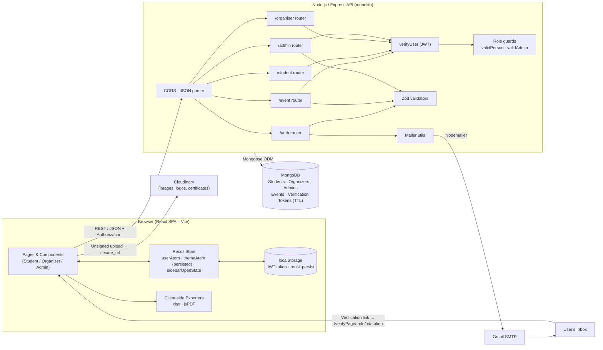

### Key design decisions

| Decision | Rationale |
|---|---|
| **Role-split routers** (`/auth`, `/event`, `/student`, `/organiser`, `/admin`) | Each role has separate responsibilities, so changing one area is unlikely to break another. |
| **Separate collections per role** (Student / Organizer / Admin) | Each role has different profile fields. Access is decided by which collection the JWT's `userId` belongs to. |
| **Direct browser → Cloudinary uploads** | The backend never handles binary files. It only stores the returned URLs, which keeps the API lightweight. |
| **Embedded sub-documents in Event** (comments, FAQs, enrolledStudents) | These are always read together with the event, so one read returns the whole event page. |
| **Two-sided enrollment** (`Event.enrolledStudents` and `Student.eventsEnrolled`) | Lookups are fast both ways: participants per event, and events per student. |
| **TTL-indexed token collections** | Verification links expire after 1 hour, and MongoDB deletes them without any cron job. |
| **Client-side exports** | Excel and PDF files are generated in the browser, so no export service is needed. |

### Role / use-case overview

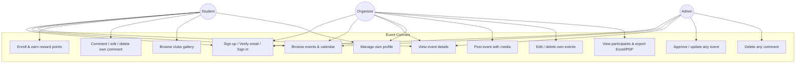

---

## Low-Level Design (LLD)

### Data model (ER diagram)

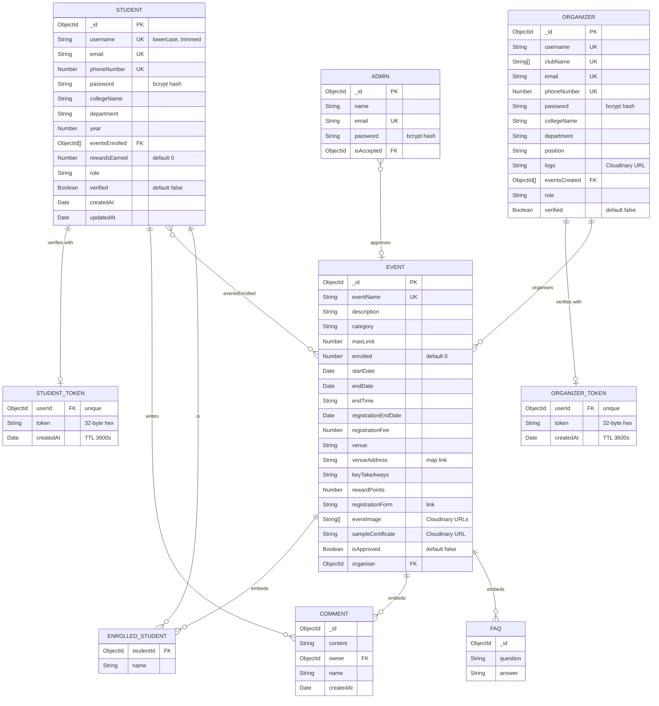

### Backend class / module diagram

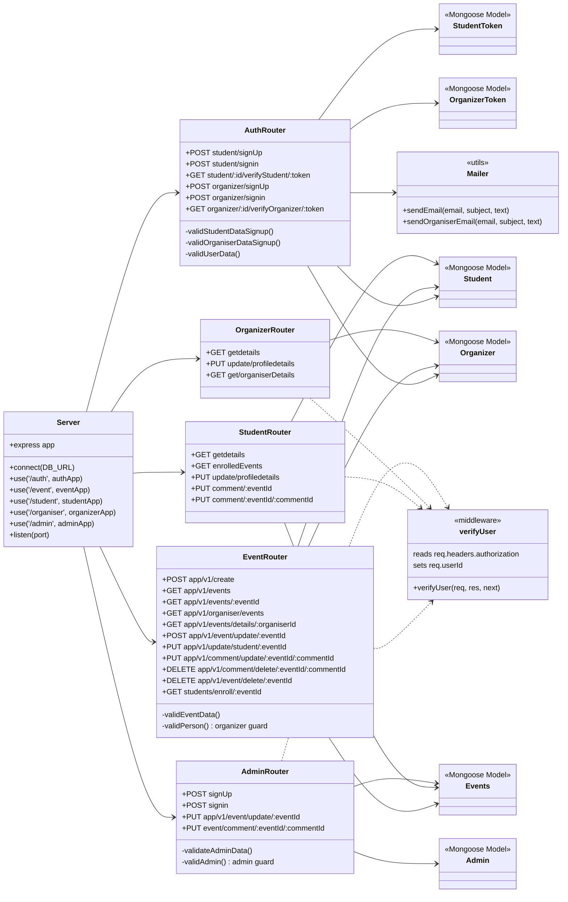

### Frontend component tree

```mermaid
flowchart TB
    Root["main.jsx<br/>RecoilRoot → MotionConfig → BrowserRouter"] --> RL["RootLayout<br/>Header (ThemeToggle) · Sidebar · Outlet · Footer · ToastContainer"]

    RL --> Pub["Public"]
    Pub --> LP[LandingPage]
    Pub --> SU["SignUp<br/>(role toggle, Cloudinary logo upload)"]
    Pub --> SI["SignIn<br/>(role select → JWT → Recoil)"]
    Pub --> VP["VerifyPage<br/>/verifyPage/:role/:id/:token"]

    RL --> SP["/student-profile/:emailId"]
    SP --> SH["Home<br/>Dock tabs → Events · Enrolled · My Calendar · Calendar · Gallery · Dashboard"]
    SP --> SD["StudentDashBoard<br/>profile + edit + rewards"]
    SP --> EE[EnrolledEvents]
    SP --> EV[Events]
    SP --> EB["EventsById<br/>details · enroll · comments"]
    SP --> CC["Customcalender (all events)<br/>→ CalendarView"]
    SP --> SC["StudentCalender (enrolled)<br/>→ CalendarView"]
    SP --> GH["GalleryHomePage (clubs)"]
    SP --> CE["ClubEvents/:clubById"]

    RL --> OP["/organizer-profile/:emailId"]
    OP --> OH["Home<br/>Dock tabs → Events · Post Event · Created · Calendar · Dashboard"]
    OP --> OD["OrganizerDashBoard<br/>profile + stats"]
    OP --> PE["PostEvent<br/>form + uploads + confetti"]
    OP --> CR[CreatedEvents]
    OP --> EB2["EventsById<br/>edit · delete"]
    OP --> EP["EventParticipants<br/>Excel / PDF export"]
    OP --> OC["OrganiserCalender<br/>→ CalendarView"]
    OP --> FE[FetchEvents]

    RL --> AP["/admin-profile/:emailId"]
    AP --> AD["AdminDashBoard<br/>shortcut cards"]
    AP --> ME["ManageEvents<br/>(coming soon)"]
    AP --> EV3[Events]
    AP --> EB3[EventsById]
```

### Sequence diagrams

#### 1. Signup and email verification

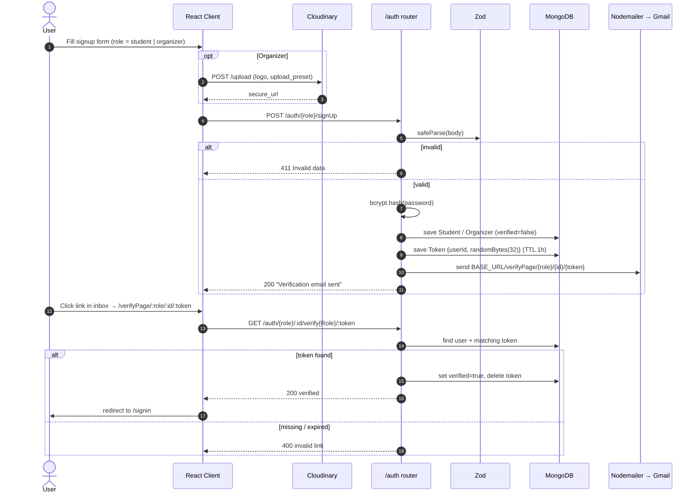

#### 2. Sign-in and authorised request

```mermaid
sequenceDiagram
    autonumber
    actor U as User
    participant C as React Client
    participant R as Recoil + localStorage
    participant A as /auth or /admin
    participant P as Protected router
    participant V as verifyUser
    participant G as Role guard
    participant DB as MongoDB

    U->>C: email, password, role
    C->>A: POST signin
    A->>DB: findOne({email})
    A->>A: bcrypt.compare
    alt not verified (student/organizer)
        A->>DB: create token if none
        A-->>C: 400 "verification email sent"
    else ok
        A->>A: jwt.sign({userId}, JWT_SECRET)
        A-->>C: 200 {token, payload}
        C->>R: localStorage.token = JWT; userAtom = {role, email, _id, isLoggedIn}
        C->>U: navigate to /{role}-profile/:id
    end

    C->>P: GET/PUT … Authorization: JWT
    P->>V: verify(JWT)
    V-->>P: req.userId
    P->>G: findById(req.userId) in Organizer/Admin
    G-->>P: next() if found
    P->>DB: query / mutate
    P-->>C: 200 payload
```

#### 3. Organizer creates an event

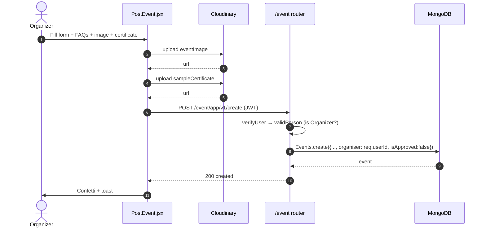

#### 4. Student enrolls in an event

```mermaid
sequenceDiagram
    autonumber
    actor S as Student
    participant C as EventsById.jsx
    participant E as /event router
    participant DB as MongoDB

    S->>C: Click "Enroll"
    C->>E: PUT /event/app/v1/update/student/:eventId {enroll:true, name, rewardPoints}
    E->>DB: Events.findById
    alt already in enrolledStudents
        E-->>C: 400 already enrolled
    else
        E->>DB: event.enrolledStudents.push({studentId,name}); enrolled += 1; save
        E->>DB: student.eventsEnrolled.push(eventId); rewardsEarned += rewardPoints; save
        E-->>C: 200 Enrolled successfully
        C->>S: toast + seat count updated
    end
```

#### 5. Organizer exports participants

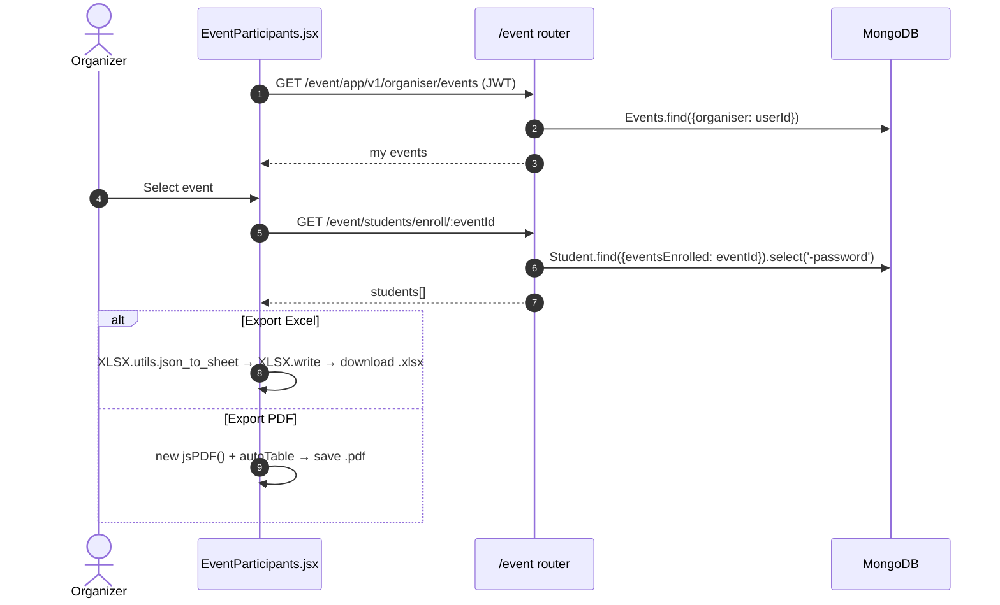

#### 6. Comment lifecycle and moderation

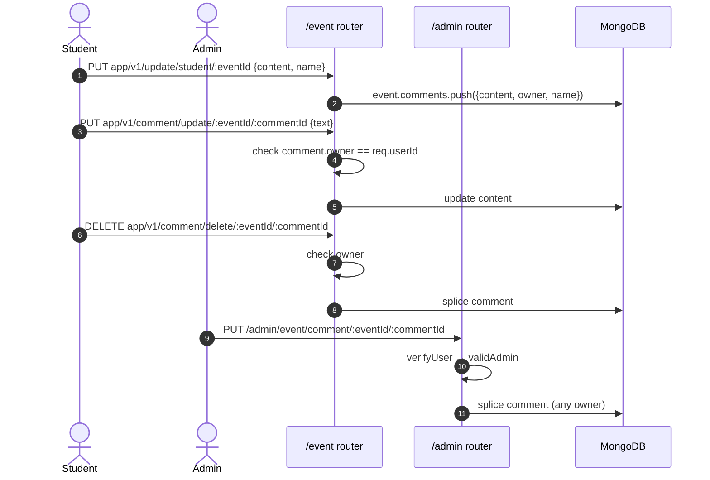

### Auth and verification state machine

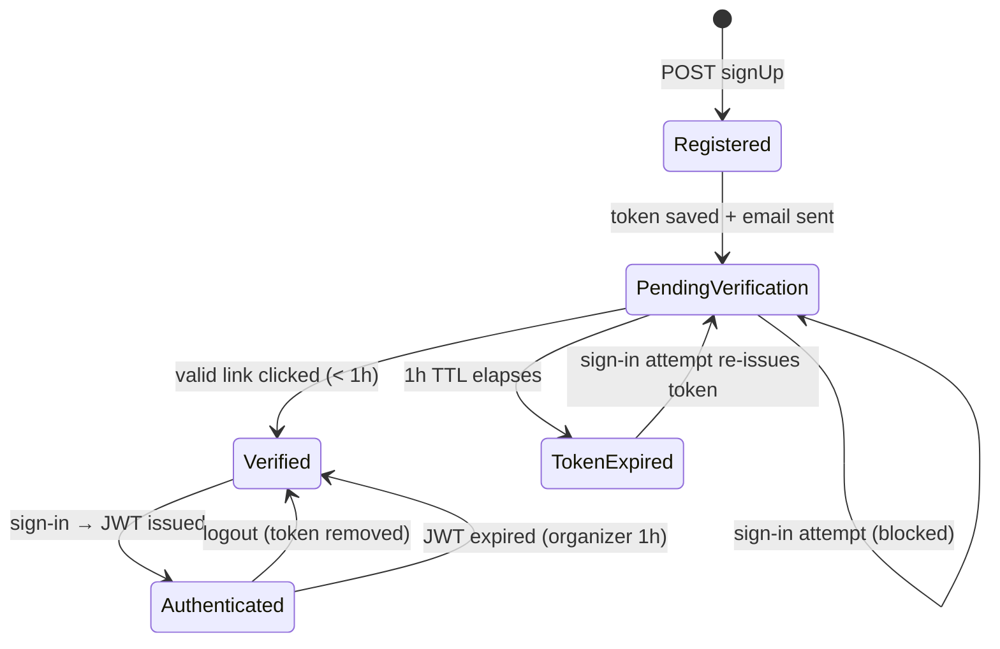

### Event lifecycle

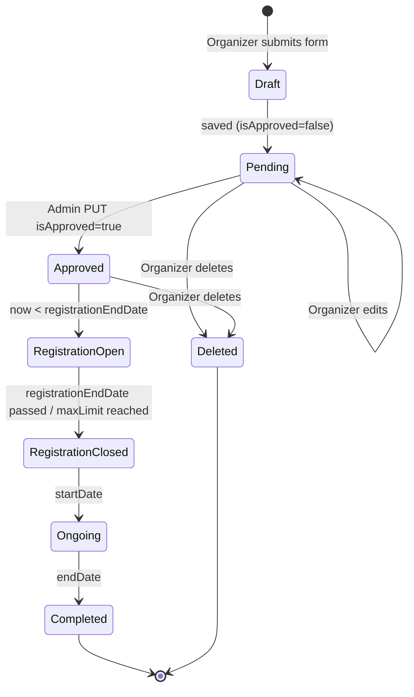

---

## API Reference

Base URL: `http://localhost:<port>`. 🔒 means the route needs the header `Authorization: <JWT>` (the raw token, no `Bearer` prefix).

### `/auth`

| Method | Endpoint | Auth | Description |
|---|---|---|---|
| POST | `/auth/student/signUp` | – | Register a student, then send the verification email |
| POST | `/auth/student/signin` | – | Student login, returns JWT |
| GET | `/auth/student/:id/verifyStudent/:token` | – | Verify student email |
| POST | `/auth/organizer/signUp` | – | Register an organizer (with logo URL), then send the verification email |
| POST | `/auth/organizer/signin` | – | Organizer login, returns a JWT (1h expiry) |
| GET | `/auth/organizer/:id/verifyOrganizer/:token` | – | Verify organizer email |

### `/event`

| Method | Endpoint | Auth | Description |
|---|---|---|---|
| POST | `/event/app/v1/create` | 🔒 Organizer | Create an event |
| GET | `/event/app/v1/events` | 🔒 | List all events |
| GET | `/event/app/v1/events/:eventId` | 🔒 | Event details plus an `isEnrolled` flag for the caller |
| GET | `/event/app/v1/organiser/events` | 🔒 Organizer | Events created by the caller |
| GET | `/event/app/v1/events/details/:organiserId` | 🔒 | Events created by a given organizer (club page) |
| POST | `/event/app/v1/event/update/:eventId` | 🔒 Organizer (owner) | Update an event |
| DELETE | `/event/app/v1/event/delete/:eventId` | 🔒 Organizer (owner) | Delete an event |
| PUT | `/event/app/v1/update/student/:eventId` | 🔒 | `{enroll:true,name,rewardPoints}` enrolls; `{content,name}` adds a comment |
| PUT | `/event/app/v1/comment/update/:eventId/:commentId` | 🔒 Owner | Edit your own comment `{text}` |
| DELETE | `/event/app/v1/comment/delete/:eventId/:commentId` | 🔒 Owner | Delete your own comment |
| GET | `/event/students/enroll/:eventId` | – | Students enrolled in an event (password excluded) |

### `/student`

| Method | Endpoint | Auth | Description |
|---|---|---|---|
| GET | `/student/getdetails` | 🔒 | Caller's profile |
| GET | `/student/enrolledEvents` | 🔒 | Events the caller is enrolled in |
| PUT | `/student/update/profiledetails` | 🔒 | Update profile |
| PUT | `/student/comment/:eventId` | 🔒 | Add a comment |
| PUT | `/student/comment/:eventId/:commentId` | 🔒 Owner | Delete your own comment |

### `/organiser`

| Method | Endpoint | Auth | Description |
|---|---|---|---|
| GET | `/organiser/getdetails` | 🔒 | Caller's organizer profile |
| PUT | `/organiser/update/profiledetails` | 🔒 | Update profile |
| GET | `/organiser/get/organiserDetails` | – | All organizers/clubs (used by the gallery) |

### `/admin`

| Method | Endpoint | Auth | Description |
|---|---|---|---|
| POST | `/admin/signUp` | – | Create an admin |
| POST | `/admin/signin` | – | Admin login, returns JWT |
| PUT | `/admin/app/v1/event/update/:eventId` | 🔒 Admin | Approve or update any event (e.g. `{isApproved:true}`) |
| PUT | `/admin/event/comment/:eventId/:commentId` | 🔒 Admin | Delete any comment |

---

## Frontend Routes

| Path | Component | Role |
|---|---|---|
| `/` | LandingPage | Public |
| `/signup` | SignUp | Public |
| `/signin` | SignIn | Public |
| `/verifyPage/:role/:id/:token` | VerifyPage | Public |
| `/student-profile/:emailId` | Home | Student |
| `…/dashboard` | StudentDashBoard | Student |
| `…/events` | Events | Student |
| `…/viewevent/:eventById` | EventsById | Student |
| `…/enrolledevents` | EnrolledEvents | Student |
| `…/calender` | Customcalender | Student |
| `…/studentCalender` | StudentCalender | Student |
| `…/galleryPage` | GalleryHomePage | Student |
| `…/club/:clubById` | ClubEvents | Student |
| `/organizer-profile/:emailId` | Home | Organizer |
| `…/dashboard` | OrganizerDashBoard | Organizer |
| `…/events` | Events | Organizer |
| `…/viewevent/:eventById` | EventsById | Organizer |
| `…/postEvents` | PostEvent | Organizer |
| `…/createdEvents` | CreatedEvents | Organizer |
| `…/eventDetails` | EventParticipants | Organizer |
| `…/view/calender` | Customcalender | Organizer |
| `…/view/organisercalender` | OrganiserCalender | Organizer |
| `…/getevents` | FetchEvents | Organizer |
| `/admin-profile/:emailId/dashboard` | AdminDashBoard | Admin |
| `…/manageEvents` | ManageEvents | Admin |
| `…/events` | Events | Admin |
| `…/viewevent/:eventById` | EventsById | Admin |

---

## Validation Rules

Enforced on the server with Zod:

- **Username**: 3–30 characters.
- **Password**: at least 8 characters, with at least one letter, at least one digit (1–9), and an `@` that is not the first character.
- **Email**: valid email format.
- **Student**: `phoneNumber` and `year` must be numbers.
- **Organizer**: `phoneNumber` is coerced to a number; `clubName`, `position`, and `logo` are required.
- **Event**: name, description, category, venue, venueAddress, keyTakeAways, registrationForm, and endTime are strings; maxLimit, registrationFee, and rewardPoints are numbers; dates are coerced; each FAQ needs a non-empty question and answer.

Uniqueness is enforced by MongoDB indexes: username, email, and phone number per role, club name, and event name.

---

## Getting Started

### Prerequisites
- Node.js 18+
- A MongoDB instance (local or Atlas)
- A Gmail account with an **App Password** (for SMTP)
- A Cloudinary account with an **unsigned upload preset**

### 1. Backend

```bash
cd Server
npm install
# create .env (see below)
npm start            # node server.js
```

### 2. Frontend

```bash
cd Client
npm install
# create .env (see below)
npm run dev          # Vite dev server → http://localhost:5173
```

Other scripts: `npm run build`, `npm run preview`, `npm run lint`.

### 3. Create an admin

There is no admin signup UI. Create one through the API:

```bash
curl -X POST http://localhost:4000/admin/signUp \
  -H "Content-Type: application/json" \
  -d '{"name":"admin","email":"admin@example.com","password":"admin@1234"}'
```

---

## Environment Variables

### `Server/.env`

| Key | Description |
|---|---|
| `DB_URL` | MongoDB connection string |
| `JWT_SECRET` | Secret used to sign JWTs |
| `port` | API port (optional, default 4000). The client calls `http://localhost:4000` |
| `USER` | Gmail address used as sender |
| `PASS` | Gmail App Password |
| `HOST` | `smtp.gmail.com` |
| `SERVICE` | `gmail` |
| `SECURE` | `false` |
| `BASE_URL` | Frontend origin for verification links, e.g. `http://localhost:5173` |
| `CLOUDINARY_CLOUD_NAME` / `CLOUDINARY_API_KEY` / `CLOUDINARY_API_SECRET` | Reserved for server-side uploads (currently unused) |

### `Client/.env`

| Key | Description |
|---|---|
| `VITE_CLOUDINARY_CLOUD_NAME` | Cloudinary cloud name |
| `VITE_CLOUDINARY_UPLOAD_PRESET` | Unsigned upload preset |

> Never commit `.env` files. Both folders already list them in `.gitignore`.

---

## Known Issues & Limitations

- **`bcrypt` vs `bcryptjs`**: `Server/apis/Auth.js` calls `require('bcrypt')`, but only `bcryptjs` is in `Server/package.json`. It works on the original machine only because `bcrypt` is installed in a parent folder (`~/node_modules`). On a fresh clone the server fails to start. Fix it with `npm i bcrypt` in `Server/`, or change the import to `bcryptjs`.
- **Port**: the server runs on its default port `4000`, and the client calls `http://localhost:4000`. If you set `port` in `Server/.env`, update the client URLs to match. On Windows, env var names are case-insensitive, so `port` and the SMTP `PORT` share one value.
- **Port 3000 conflicts**: if another program (e.g. Docker/WSL) owns port 3000 and the client is pointed there, the browser reports a misleading **CORS** error. The client was moved to port 4000 for this reason.
- **Hard-coded API URL**: the client has `http://localhost:4000` in each component. Moving it to a `VITE_API_URL` variable would make deployment easier.
- **Admin UI**: the admin dashboard shows shortcut cards, and `ManageEvents` is a "coming soon" page. Event approval and comment moderation are available only through the API.
- **Theme transition**: the circular reveal needs the View Transitions API (Chrome/Edge). Other browsers switch themes instantly.
- **Approval is not enforced**: events are listed whether or not `isApproved` is set.
- **Student / admin JWTs never expire**. Only organizer tokens have `expiresIn: 1h`.
- **Role guards**: if the user is not found, `validPerson` and `validAdmin` never respond, so the request hangs instead of returning 403.
- `GET /event/students/enroll/:eventId` is not protected.
- Enrollment does not check `maxLimit` or `registrationEndDate` on the server.
- No pagination, search, rate limiting, caching, or automated tests yet.
- `Client/src/routes.jsx` is an unused draft router. The live routes are in `main.jsx`.

---

## Future Improvements

- Admin UI for approvals, moderation, and analytics (the dashboard shortcuts are already in place).
- Show only approved events to students, and enforce seat and deadline limits on the server.
- Central Axios instance with base URL and interceptors (auth header, 401 → logout).
- Refresh tokens and consistent JWT expiry across roles.
- Pagination, search, and category filters for events.
- Email notifications for enrollment confirmations and event reminders.
- Certificates generated automatically after event completion.
- Leaderboard based on reward points.
- Rate limiting (`express-rate-limit`), Helmet, and a stricter CORS origin.
- Unit and integration tests (Jest + Supertest), plus CI.
- Docker Compose for one-command local setup.
