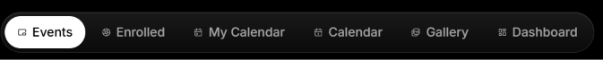
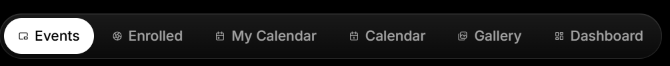

# Event Connect — Change Plan & Log

Running record of every change made to this project, newest phase last.
Each step lists the files touched and how it was verified.

**How changes are checked:** I don't start the dev server; you test in the browser. Before marking a step done, I:
1. Parse every changed `.jsx` file with esbuild (syntax).
2. Run ESLint with `no-undef` (catches missing imports and undefined variables).
3. Compile `index.css` with Tailwind (catches bad `@apply` classes).
4. Keep API calls, form validation and navigation logic unchanged unless the step says otherwise.

---

## Phase 1 — Documentation (done)

| Change | Files |
|---|---|
| Wrote a project README: features, tech stack, HLD/LLD Mermaid diagrams, API reference, routes, setup, known issues | `README.md` (new) |

---

## Phase 2 — Black & white "Mac app" restyle of 4 pages (done)

| Change | Files |
|---|---|
| Installed `gsap` and `@gsap/react` | `Client/package.json` |
| Glass utility classes (`.glass`, `.glass-strong`, `.glass-bar`, `.text-gradient`) | `Client/src/index.css` |
| Inter font loaded; set as Tailwind `sans` | `Client/index.html`, `Client/tailwind.config.js` |
| Header → glass bar with spring entrance | `common/Header.jsx` |
| Landing → GSAP intro timeline, mouse parallax orbs, ScrollTrigger feature cards, blur word-swap, floating sample cards | `common/LandingPage.jsx` |
| Home → pill tab toolbar (sliding `layoutId` highlight), animated panel | `common/Home.jsx` |
| Footer → glass panel (was an empty fixed div) | `common/Footer.jsx` |
| Removed desktop imitation (Dock, traffic lights, menu-bar clock) per feedback; deleted `Dock.jsx`, `hooks/use-clock.js` | — |
| Removed the Event Connect logo mark (header, footer, landing CTA) | `Header.jsx`, `Footer.jsx`, `LandingPage.jsx` |

---

## Phase 3 — Restyle all remaining pages (done)

| Change | Files |
|---|---|
| Shared form/button classes: `.field`, `.field-label`, `.field-error`, `.btn-primary`, `.btn-ghost`, `.chip` | `index.css` |
| Shared UI kit: `Page`, `PageHeader`, `EmptyState`, `Spinner`, stagger variants | `components/ui/Page.jsx` (new) |
| Shared glass `EventCard` (image, category, open/closed, dates, seats) | `components/ui/EventCard.jsx` (new) |
| `StatTile`, `InfoRow`, `Avatar` | `components/ui/Stat.jsx` (new) |
| Shared `CalendarView` (month grid, day list, portaled modal) | `components/ui/CalendarView.jsx` (new) |
| Auth pages restyled (sliding role pill, 2-col signup, spinner verify page) | `SignIn.jsx`, `SignUp.jsx`, `VerifyPage.jsx` |
| Sidebar → glass rail with sliding active pill; nav logic unchanged | `common/Sidebar.jsx` |
| Content offset fixed (sidebar width matched; full width on public pages) | `RootLayout.jsx` |
| Event lists → shared card + loading/empty states | `Events.jsx`, `ClubEvents.jsx`, `EnrolledEvents.jsx`, `CreatedEvents.jsx`, `FetchEvents.jsx` |
| Gallery → shows the club's uploaded logo (was a hard-coded image) | `GalleryHomePage.jsx` |
| Event details → hero, info panels, animated FAQ/comments; now shows key takeaways, Maps link, form link, certificate. Logic lines kept verbatim | `EventsById.jsx` |
| Dashboards → profile header, stat tiles (organizer: total/ongoing/upcoming/completed) | `StudentDashBoard.jsx`, `OrganizerDashBoard.jsx` |
| Participants → Excel/PDF buttons replace the dropdown | `EventParticipants.jsx` |
| Post Event → grouped sections, animated FAQ rows, confetti portaled | `PostEvent.jsx` |
| Calendars → use `CalendarView`, monochrome status tones | `Customcalender.jsx`, `StudentCalender.jsx`, `OrganiserCalender.jsx` |
| Admin placeholders → dashboard shortcuts / "coming soon" | `AdminDashBoard.jsx`, `ManageEvents.jsx` |
| Calendar CSS → monochrome | `index.css` |

### Bug fixes in Phase 3
- **CORS error on sign in/up:** port 3000 is taken by Docker/WSL, so API calls hit a container. The Express server runs on 4000. All client URLs changed `localhost:3000` → `localhost:4000` (17 files). README updated to match.
- **`sidebarVisible is not defined`:** HMR caught `RootLayout.jsx` between two edits; the file was correct. A refresh fixes it.

Verification: all `.jsx` parse; ESLint `no-undef` clean; Tailwind compiles.

---

## Phase 4 — Dark/light themes, floating header, Aceternity UI (done — please test)

**Goal:** a dark and a light theme with a toggle, smoother Framer and GSAP animation, a rounded floating header with spacing, and Aceternity UI-style components across the app.

### Approach
- **Theming without rewriting every component:** Tailwind's `white`, `black` and `neutral-*` now resolve to CSS variables. In light mode they swap: `white` becomes ink, `black` becomes paper, and the neutral scale reverses. Existing classes theme themselves.
- The theme is stored in Recoil (persisted) and applied as `html.dark` or `html.light`. An inline script in `index.html` applies it before React loads, so there's no flash. Toggling uses the View Transitions API for a circular reveal and falls back to an instant switch.
- Aceternity-style components are built locally with Framer Motion and Tailwind (no new dependencies).

### Steps
| # | Step | Files | Status |
|---|---|---|---|
| 4.1 | Theme tokens: CSS variables, light palette, themed glass/calendar/body, Tailwind colour mapping, keyframes (spotlight, meteor, shimmer) | `tailwind.config.js`, `index.css` | done |
| 4.2 | Theme state (`themeAtom`, persisted) + `useTheme` hook + `ThemeToggle` (sun/moon swap, circular reveal via View Transitions); inline no-flash script | `components/theme/useTheme.js` (new), `components/theme/ThemeToggle.jsx` (new), `index.html` | done |
| 4.3 | Aceternity components (Framer Motion + Tailwind, no new deps): `Spotlight`, `FlipWords`, `TextGenerateEffect`, `MovingBorderButton`, `HoverGrid` (card hover effect), `TiltCard` (3D card + sheen), `BentoGrid`/`BentoGridItem`, `Meteors`, `BackgroundGradient`, `InfiniteMovingCards` (GSAP marquee, slows on hover), `DotBackground` | `components/ui/aceternity/*` (11 new files) | done |
| 4.4 | Header → floating rounded pill (`top-4`, side gaps, `rounded-full`), hides on scroll down and returns on scroll up, shadow once scrolled, theme toggle, mobile sidebar toggle moved here | `Header.jsx` | done |
| 4.5 | Sidebar → floating rounded panel (`left-4 top-24 bottom-4`); content offset `md:ml-64` / `md:ml-24`; `main` gets `pt-24` to clear the header; global `DotBackground`; toasts follow theme; Home toolbar sticks at `top-24`, duplicate orbs removed | `Sidebar.jsx`, `RootLayout.jsx`, `Home.jsx` | done |
| 4.6 | Applied Aceternity components (see "Where each component is used") | Landing, auth, lists, gallery, `EventCard`, `Page.jsx` | done |
| 4.7 | Theme-proofed hard-coded colours: calendar event tones use CSS vars; map invert only in dark (`dark:` filter); grid lines/dots use `--c-white`; confetti has dark + light pieces; club logo tile pinned to real white | `CalendarView.jsx`, `EventsById.jsx`, `LandingPage.jsx`, `PostEvent.jsx`, `GalleryHomePage.jsx` | done |
| 4.8 | App-wide `MotionConfig reducedMotion="user"` | `main.jsx` | done |
| 4.9 | Verification pass | — | done |

### Where each component is used
| Component | Used in |
|---|---|
| Spotlight, FlipWords, TextGenerateEffect, MovingBorderButton | Landing hero |
| TiltCard | Landing sample cards, every `EventCard`, Gallery club cards |
| InfiniteMovingCards (GSAP) | Landing — event types marquee (descriptive copy, not testimonials) |
| BentoGrid | Landing features |
| BackgroundGradient + Meteors | Landing CTA, Sign In, Sign Up cards |
| Meteors | `EmptyState` (all lists) |
| HoverGrid | Events, Club Events, Enrolled, Created, Fetch Events, Gallery |
| TextGenerateEffect | Every `PageHeader` subtitle |
| DotBackground | Whole app (`RootLayout`) |

### Content changes requested during this phase
- Landing hero paragraph shortened to two lines: "Hackathons, workshops, fests and meetups — all in one place." / "Discover, enroll and earn rewards."

### Verification (4.9)
- esbuild: every `.js`/`.jsx` in `src` parses ✅
- ESLint `no-undef`: no undefined identifiers ✅
- Tailwind compile ✅. Checked the output: `.text-white` → `rgb(var(--c-white) / …)`, `.bg-white/10` → `rgb(var(--c-white) / 0.1)`, `html.light` palette present, `animate-spotlight` / `animate-meteor` keyframes generated, map filter scoped to `.dark` ✅
- Not run: the dev server and the browser (you test these).

### What to check in the browser
1. Toggle the theme from the header: there's a circular reveal (Chrome/Edge; other browsers switch instantly). Reload: the theme sticks with no flash.
2. Scroll down any page: the header slides away. Scroll up: it returns.
3. On a phone: the sidebar button is in the header and the sidebar floats in from the left.
4. Light mode: text, glass cards, calendar, map and toasts are all readable.

### Fix 4.10 — "UI is broken in the landing page" (awaiting screenshot to confirm)
Found by reading the code (no browser here):
| Problem | Cause | Fix | File |
|---|---|---|---|
| A huge blurred light shape across the whole landing page | `Spotlight` was absolutely positioned in the full-page container, so `h-[169%] w-[138%]` was relative to thousands of pixels | Moved it into the hero inside a clipped `-z-10` wrapper, sized to the hero only | `LandingPage.jsx` |
| Headline jumps / "Find" snaps sideways on every word change | `FlipWords` used `mode="wait"` while the exiting word is `position:absolute`, leaving a frame with no word in the layout | Removed `mode="wait"` (Aceternity's behaviour); made the `h1` `relative` so the exiting word stays in place | `FlipWords.jsx`, `LandingPage.jsx` |

Verified: both files parse; ESLint `no-undef` clean.

---

## Phase 5 — Remove Aceternity, back to clean & simple (done — please test)

**Request:** keep the dark/light theme, smooth Framer + GSAP motion, and the rounded header with spacing. Remove the Aceternity components and extra animations. Go back to the clean Phase 3 design, responsive.

| # | Step | Files | Status |
|---|---|---|---|
| 5.1 | Landing → Phase 3 layout (GSAP intro + scroll reveals, blur word-swap, glass feature cards, glass CTA). Two-line hero copy kept; colours theme-aware. Removed: Spotlight, FlipWords, TextGenerate, MovingBorder, Tilt, marquee, Bento, Meteors/BackgroundGradient, mouse parallax, orb drift, card float loop | `LandingPage.jsx` | done |
| 5.2 | Lists → plain staggered grid (no HoverGrid); `EventCard` → simple hover lift (no tilt) | `Events`, `ClubEvents`, `EnrolledEvents`, `CreatedEvents`, `FetchEvents`, `ui/EventCard.jsx` | done |
| 5.3 | Gallery → plain staggered grid with hover lift | `GalleryHomePage.jsx` | done |
| 5.4 | Sign In / Sign Up → plain glass card (no gradient border/meteors) | `SignIn.jsx`, `SignUp.jsx` | done |
| 5.5 | `PageHeader` → simple fade (no word-by-word); `EmptyState` → no meteors | `ui/Page.jsx` | done |
| 5.6 | Header → stays visible (no hide-on-scroll); keeps the rounded floating pill, spacing, theme toggle, shadow when scrolled | `Header.jsx` | done |
| 5.7 | Remove the dot background; delete `components/ui/aceternity/`; drop spotlight/meteor/shimmer keyframes | `RootLayout.jsx`, `tailwind.config.js` | done |
| 5.8 | Verification pass | — | done |

### Verification (5.8)
- No remaining references to Aceternity components (grep) ✅; `components/ui/aceternity/` deleted (11 files)
- esbuild: every `.js`/`.jsx` parses ✅
- ESLint `no-undef`: clean ✅
- Tailwind compiles ✅
- `vite build` (to a temp folder, not the project): 7272 modules, built OK ✅
- Not run: the dev server / browser (you test)

### What is kept from Phase 4
- Dark/light theme (CSS variables, sun/moon toggle with circular reveal, saved choice, no flash)
- Rounded floating header with spacing (`top-4`, side gaps, `rounded-full`), now always visible
- Floating rounded sidebar and layout spacing
- `MotionConfig reducedMotion="user"`; calendar/map/confetti theme fixes

### Animation inventory after cleanup
- Framer: header fade-in, page fade-up, staggered card grids, gentle hover lift (-4px), tab/sidebar sliding pill, hero word swap, modal/FAQ/comment transitions, theme icon swap
- GSAP: landing intro (hero copy → sample cards), one-time scroll fade-ups (features, CTA), Home intro
- Removed: mouse parallax, orb drift, card float loop, header hide-on-scroll, 3D tilt, marquee, meteors, spotlight, moving border

---

## Phase 6 — Calendar UI + unreadable calendar text (done — please test)

**Problem:** calendar text blends into the background, and toolbar buttons are hard to read, depending on the theme.
**Root cause:** `react-big-calendar.css` is imported by `CalendarView` *after* `index.css`. Its rules have the same specificity as ours, so the later file wins and brings back hard-coded colours: `#e6e6e6` off-range cells, `#eaf6ff` today, `#373a3c` toolbar buttons, a white "+N more" popup, `#999` off-range dates.

| # | Step | Files | Status |
|---|---|---|---|
| 6.1 | Scope all calendar styles under `.ec-calendar` (higher specificity, so they always win), fully theme-aware; style the today badge, selected day, "+N more" link and popup | `index.css` | done |
| 6.2 | Custom toolbar (month title, Today, prev/next) replaces the library's buttons | `ui/CalendarView.jsx` | done |
| 6.3 | Day panel: opens on today by default, lists events that *span* the selected day (was start-day only), shows a count; selected day highlighted in the grid | `ui/CalendarView.jsx` | done |
| 6.4 | Verification pass | — | done |

### Verification (6.4)
- Built CSS checked: every library colour rule that affects the month view (`#e6e6e6`, `#eaf6ff`, `#999`, `#ddd` borders, `#fff` overlay, `#3174ad`/`#265985` "+N more", toolbar `#373a3c`) is overridden by a higher-specificity `.ec-calendar …` rule, or no longer rendered (custom toolbar) ✅
- esbuild parse, ESLint `no-undef`, Tailwind compile, `vite build` ✅
- Removed the now-unused `emptyHint` prop from `Customcalender.jsx` and `StudentCalender.jsx`

---

## Phase 7 — macOS Dock–style tab bar on Home (done — please test)

**Request:** a macOS taskbar (Dock) animation for the Home tabs (Events, Enrolled, My Calendar, Calendar, Gallery, …), centered, using Framer + GSAP.

| # | Step | Files | Status |
|---|---|---|---|
| 7.1 | `Dock` component. Framer: cursor-proximity magnification (spring), tooltip label, active dot, sliding active state. GSAP: launch bounce on click, staggered rise-in on mount. Touch screens: no magnification, small labels under the icons | `ui/Dock.jsx` (new) | done |
| 7.2 | Home: replace the pill toolbar with the centered Dock (sticky under the header); tab logic unchanged | `common/Home.jsx` | done |
| 7.3 | Verification pass | — | done |

### Icon refresh (requested mid-phase)
Home tab icons switched from Tabler to cleaner **lucide-react** icons (already a dependency), shown in rounded app-style tiles:
| Tab | Icon |
|---|---|
| Events | `Compass` |
| Enrolled | `Ticket` |
| My Calendar | `CalendarHeart` |
| Post Event | `SquarePlus` |
| Created | `FolderKanban` |
| Calendar | `CalendarDays` |
| Gallery | `Images` |
| Dashboard | `LayoutDashboard` |

### How the Dock behaves
- **Desktop (mouse, ≥768px):** tiles grow as the cursor approaches (46px → 66px, Framer spring); the label appears as a tooltip; the active tile is solid with a dot underneath. Clicking plays a GSAP launch bounce. The Dock is centered and sticks under the header.
- **Phones/touch:** no magnification; each tile shows a small caption; the bar scrolls sideways if needed.
- **On load:** tiles drop in one after another (GSAP, `back.out`).
- Reduced-motion users get no bounce or rise-in.

### Verification (7.3)
- esbuild parse, ESLint `no-undef`, `vite build` ✅
- Not run: the dev server / browser (you test)

---

## Phase 8 — Clean up the Home Dock animation (done — please test)

**Feedback:** the animation on the top bar of the dashboard (Home) page isn't good; make it clean.

| Problem (from code review) | Fix |
|---|---|
| Magnification changed each tile's width/height, so the centered bar resized and slid sideways as the mouse moved | Magnify with `scale` only (1 → 1.18). The layout never moves and tiles stay inside the bar |
| Two entrance animations on the same bar (Dock's own GSAP drop-in + Home's GSAP intro) | Removed the Dock's drop-in; Home's single fade-up remains |
| Magnified tiles spilled outside the glass bar; the bounce moved downward | Tiles scale within the bar padding; the click is a subtle GSAP press (0.92 → 1) |
| Labels only in hover tooltips; per-tile dots faded in/out | Labels always under the icons; one active indicator that slides between tabs (Framer `layoutId`) |

| # | Step | Files | Status |
|---|---|---|---|
| 8.1 | Rewrite Dock animation as above | `ui/Dock.jsx` | done |
| 8.2 | Verification pass | — | done |

### Verification (8.2)
- esbuild parse, ESLint `no-undef`, `vite build` ✅
- Not run: the dev server / browser (you test)

### Follow-up 8.3 — "add some extra width and make animation more smoother" (done)
| Setting | Before | After |
|---|---|---|
| Tile slot width | 60px / 68px (sm) | 68px / 84px (sm) |
| Tile size / icon | 44px / 20px | 48px / 22px |
| Bar padding / gap / radius | px-2–3, gap 1–1.5, 22px | px-3–5, gap 1.5–2, 26px |
| Magnify spring | stiffness 260, damping 22, mass 0.4 | stiffness 150, damping 24, mass 0.6 (no overshoot) |
| Magnify reach / peak | 120px / 1.18× | 170px / 1.16× (gentler falloff) |
| Active indicator spring | 420 / 34 | 260 / 30, mass 0.8; width 20→24px |
| Click press (GSAP) | 0.92→1, back.out(3), 0.45s | 0.94→1, power3.out, 0.6s |
| Colour transitions | 300ms | 500ms ease-out |

Verified: esbuild parse, ESLint `no-undef`, Tailwind compile ✅

---

## Phase 9 — README update (done)

Brought `README.md` in line with Phases 2–8:
| Section | Change |
|---|---|
| Intro | Describes the B&W glass UI, dark/light themes, floating header, Dock, Framer + GSAP; links `plan.md` |
| Table of contents | Added **UI & Design System**; renumbered |
| Features | Calendars (opens on today, multi-day day panel), Home Dock (student & organizer), admin dashboard shortcuts; UI/UX list rewritten |
| Tech stack | Added an Animation row (Framer Motion, GSAP + `@gsap/react`) and an Icons row (lucide for the Dock, Tabler elsewhere); noted that moment comes with react-big-calendar |
| **New: UI & Design System** | Look and feel, theming explanation + Mermaid diagram + file table, layout, animation inventory, shared `ui/` components |
| Project structure | Added `theme/`, `ui/` (Page, EventCard, Stat, CalendarView, Dock), `index.css`, `index.html`, `plan.md` |
| HLD / component tree | `themeAtom` in the store; `MotionConfig`, ThemeToggle, Home Dock tabs, CalendarView, admin pages |
| Known issues | `bcrypt` explained accurately (it resolves only from `~/node_modules` on this machine); port 3000 / misleading CORS note; admin UI status; View Transitions note |
| Future improvements | Admin item reworded |

Checked: all table-of-contents links resolve to headings (fixed a pre-existing broken "Auth & Verification State Machine" link); 14 Mermaid blocks intact.

### Notes / limitations
- The circular theme reveal needs the View Transitions API (Chromium). Elsewhere it falls back to an instant switch.
- 3D tilt turns off on touch screens and for reduced-motion users.
